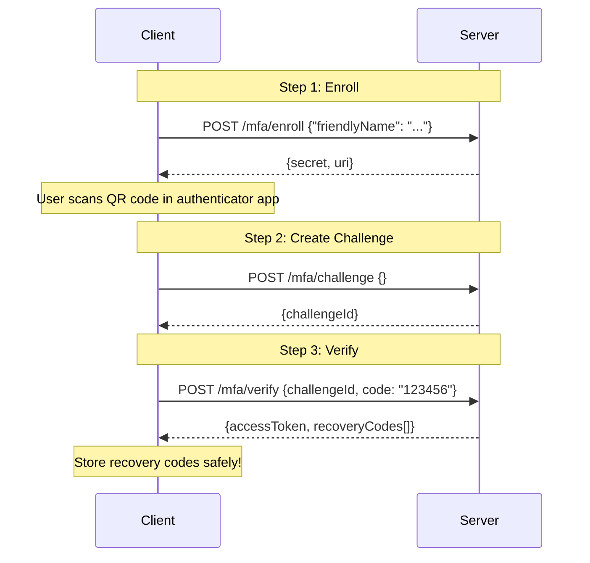
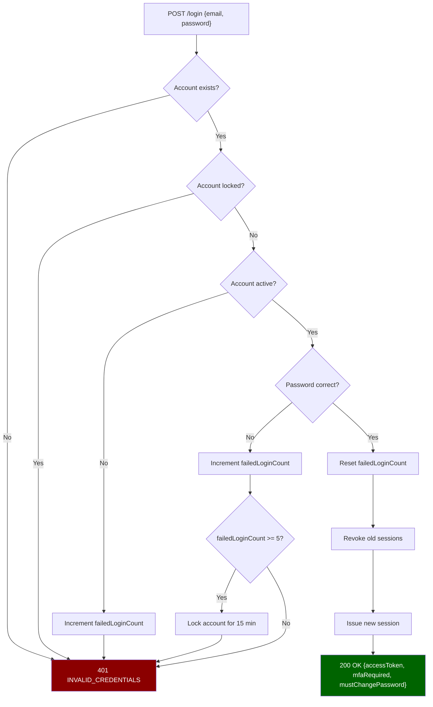
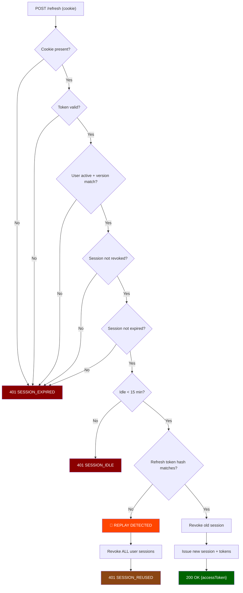

# RxFlow Backend — API Documentation

> **Version**: 0.1.0 &nbsp;|&nbsp; **Base URL**: `http://localhost:5000` &nbsp;|&nbsp; **API Prefix**: `/api/v1`

---

## Table of Contents

1. [Architecture Overview](#1-architecture-overview)
2. [Getting Started (Developer Onboarding)](#2-getting-started-developer-onboarding)
3. [Authentication & Authorization](#3-authentication--authorization)
4. [Standard Response Envelope](#4-standard-response-envelope)
5. [Error Codes Catalog](#5-error-codes-catalog)
6. [Rate Limiting](#6-rate-limiting)
7. [API Reference — Health Check](#7-api-reference--health-check)
8. [API Reference — Registration & Login](#8-api-reference--registration--login)
9. [API Reference — Session Management](#9-api-reference--session-management)
10. [API Reference — Password Management](#10-api-reference--password-management)
11. [API Reference — MFA (Multi-Factor Authentication)](#11-api-reference--mfa-multi-factor-authentication)
12. [API Reference — Staff Management (Admin)](#12-api-reference--staff-management-admin)
13. [API Reference — Clinic Settings (Admin)](#13-api-reference--clinic-settings-admin)
14. [API Reference — Patients and Visit Queue](#14-api-reference--patients-and-visit-queue)
15. [API Reference — Prescriptions and Patient QR](#15-api-reference--prescriptions-and-patient-qr)
16. [Appointments](#16-appointments)
17. [Database Models](#17-database-models)
18. [Security Design](#18-security-design)
19. [Environment Configuration](#19-environment-configuration)
20. [Authentication Flow Diagrams](#20-authentication-flow-diagrams)

---

## 1. Architecture Overview

```
Technology Stack
├── Runtime:       Node.js (ESM)
├── Framework:     Express 5
├── Language:      TypeScript (strict)
├── Database:      MongoDB Atlas (Mongoose 9)
├── Auth:          JWT (access + refresh), bcrypt, TOTP (otplib)
├── Validation:    Zod 4
├── Logging:       Pino + pino-http
├── Security:      Helmet, CORS, express-rate-limit
└── Encryption:    AES-256-GCM (Node.js crypto)
```

### Module Structure
```
src/
├── app.ts                    # Express app factory
├── server.ts                 # Entry point (DB connect + listen)
├── config/
│   ├── db.ts                 # MongoDB connection
│   └── env.ts                # Zod-validated environment config
├── middleware/
│   ├── auth.ts               # requireAuth, requireRole, requireAdminMfa, requirePasswordReady
│   ├── error-handler.ts      # Global error handler
│   └── validation.ts         # Zod body validation middleware
├── modules/
│   ├── audit/                # Audit logging
│   ├── auth/                 # Auth routes, schemas, service, session model
│   ├── clinics/              # Clinic settings routes, schemas, service, model
│   ├── patients/             # Patient registry, search, history, and numbered visit queue
│   ├── prescriptions/        # Doctor-authored final prescriptions
│   └── users/                # User model
├── shared/
│   ├── async-handler.ts      # Async route wrapper
│   ├── encryption.ts         # AES-256-GCM encrypt/decrypt
│   ├── errors.ts             # AppError class
│   ├── jwt.ts                # JWT sign/verify helpers
│   ├── security.ts           # Cookie helpers, hashing, email normalization
│   └── validation.ts         # Shared Zod schemas (email, password, objectId)
└── types/
    └── express.d.ts          # req.auth type augmentation
```

---

## 2. Getting Started (Developer Onboarding)

### Prerequisites
- Node.js ≥ 20
- MongoDB Atlas cluster (or local MongoDB 7+)
- A `.env` file (copy from `.env.example`)

### Setup Steps
```bash
# 1. Install dependencies
npm install

# 2. Copy and configure environment
cp .env.example .env
# Edit .env with your MongoDB URI, JWT secrets (64-char hex), encryption key

# 3. Start development server
npm run dev
# → Server starts on http://localhost:5000

# 4. Verify health
curl http://localhost:5000/health
# → {"status":"ok","timestamp":"2026-08-01T..."}
```

### Available Scripts
| Command | Description |
| :--- | :--- |
| `npm run dev` | Start dev server with hot reload (tsx watch) |
| `npm run build` | Compile TypeScript to `dist/` |
| `npm start` | Run production build from `dist/` |
| `npm run typecheck` | Type-check without emitting |
| `npm test` / `npm run test:unit` | Run database-independent unit tests |
| `npm run test:integration` | Run integration suites against an ephemeral `mongodb-memory-server` replica set |
| `npm run test:all` | Run unit and integration suites sequentially |
| `npm run test:watch` | Run tests in watch mode |
| `npm run audit` | Fail on high/critical npm audit findings |

---

## 3. Authentication & Authorization

### Authentication Scheme: JWT Bearer Tokens

RxFlow uses a **dual-token** architecture:

| Token | Transport | Lifetime | Purpose |
| :--- | :--- | :--- | :--- |
| **Access Token** | `Authorization: Bearer <token>` header | 15 minutes | Authenticate API requests |
| **Refresh Token** | `HttpOnly` cookie (`rxflow_refresh`) | 7 days | Silently obtain new access tokens |

### Access Token Claims (JWT Payload)
```json
{
  "userId": "6a6cf098...",
  "clinicId": "6a6cf098...",
  "role": "admin",
  "sessionVersion": 1,
  "sessionId": "uuid-v4",
  "mfaVerified": true,
  "type": "access",
  "iat": 1785573723,
  "exp": 1785574623
}
```
### Refresh Token Cookie Properties
```
Name:       rxflow_refresh (configurable via AUTH_COOKIE_NAME)
HttpOnly:   true (never exposed to JavaScript)
Secure:     true in production
SameSite:   strict
Path:       /api/v1/auth
Max-Age:    7 days (configurable via SESSION_MAX_DAYS)
```

### Authorization Layers (Middleware Stack)

| Middleware | Purpose | Error on Failure |
| :--- | :--- | :--- |
| `requireAuth` | Validates Bearer token, checks user active, session valid, idle timeout | `401 UNAUTHENTICATED`, `401 ACCOUNT_DISABLED`, `401 SESSION_REVOKED`, `401 SESSION_IDLE` |
| `requirePasswordReady` | Blocks users with `mustChangePassword: true` | `403 PASSWORD_CHANGE_REQUIRED` |
| `requireAdminMfa` | Compatibility pass-through; MFA enrollment remains available but is not required for password-only admin sessions | — |
| `requireRole('admin')` | Checks user role against allowed roles | `403 FORBIDDEN` |

### Permission Matrix

| Endpoint | Auth | Password Ready | Role |
| :--- | :---: | :---: | :--- |
| `POST /clinic-signup` | — | — | Public |
| `POST /login` | — | — | Public |
| `POST /refresh` | — | — | Cookie only |
| `POST /logout` | ✅ | — | Any |
| `GET /me` | ✅ | — | Any |
| `POST /password/change` | ✅ | — | Any |
| `POST /password/complete-first-sign-in` | ✅ | Must be pending | Any staff |
| `POST /password/forgot` | — | — | Public |
| `POST /password/reset` | — | — | Public, single-use token |
| `POST /mfa/enroll` | ✅ | — | Admin |
| `POST /mfa/challenge` | ✅ | — | Admin |
| `POST /mfa/verify` | ✅ | — | Admin |
| `POST /mfa/recover` | — | — | Platform support key |
| `POST /staff` | ✅ | ✅ | Admin |
| `GET /staff` | ✅ | ✅ | Admin |
| `POST /staff/:userId/disable` | ✅ | ✅ | Admin |
| `POST /staff/:userId/enable` | ✅ | ✅ | Admin |
| `POST /staff/:userId/reset-password` | ✅ | ✅ | Admin |

---

## 4. Standard Response Envelope

### Success Response
```json
{
  "success": true,
  "data": { ... }
}
```

### Error Response
```json
{
  "success": false,
  "error": {
    "code": "ERROR_CODE",
    "message": "Human-readable error description",
    "fields": {                          // Optional — only for validation errors
      "email": ["Expected string, received number"],
      "password": ["String must contain at least 12 character(s)"]
    }
  }
}
```

### HTTP Status Codes Used

| Status | Meaning | When Used |
| :---: | :--- | :--- |
| `200` | OK | Successful GET, POST (login, refresh, etc.) |
| `201` | Created | Resource created (signup, create staff) |
| `400` | Bad Request | Validation error, weak password |
| `401` | Unauthorized | Invalid credentials, expired token, revoked session |
| `403` | Forbidden | Insufficient role or password change required |
| `404` | Not Found | User/resource not found |
| `423` | Locked | Account temporarily locked due to failed login attempts |
| `429` | Too Many Requests | Rate limit exceeded |
| `500` | Internal Server Error | Unexpected server error |
| `503` | Service Unavailable | Database not connected (on `/ready`) |

---

## 5. Error Codes Catalog

### Authentication Errors

| Code | Status | Message | Trigger Scenario |
| :--- | :---: | :--- | :--- |
| `INVALID_CREDENTIALS` | 401 | Unable to authenticate with the supplied credentials | Wrong email/password, duplicate email on signup, inactive account |
| `UNAUTHENTICATED` | 401 | Authentication required | Missing/invalid Bearer token, user not found |
| `TOKEN_EXPIRED` | 401 | Access token expired | JWT `exp` claim has passed |
| `TOKEN_INVALID` | 401 | Invalid access token | Malformed JWT, wrong secret, refresh token used as access |
| `SESSION_EXPIRED` | 401 | Session expired | Refresh token expired, user session version mismatch |
| `SESSION_REVOKED` | 401 | Session revoked | Session was explicitly revoked (logout, password change) |
| `SESSION_REUSED` | 401 | Session revoked | Refresh token replay detected → all user sessions revoked |
| `SESSION_IDLE` | 401 | Session expired due to inactivity | No request within `SESSION_IDLE_MINUTES` (default: 15 min) |
| `REFRESH_TOKEN_INVALID` | 401 | Invalid refresh token | Malformed refresh JWT or wrong type |
| `ACCOUNT_LOCKED` | 423 | Account temporarily locked | `MAX_LOGIN_ATTEMPTS` (5) failed logins → locked for `LOCKOUT_MINUTES` (15) |

### Authorization Errors

| Code | Status | Message | Trigger Scenario |
| :--- | :---: | :--- | :--- |
| `FORBIDDEN` | 403 | Insufficient permissions | User role doesn't match required role |
| `FORBIDDEN` | 403 | Administrator access required | Non-admin trying MFA operations |
| `FORBIDDEN` | 403 | Platform support authorization required | Invalid/missing `x-platform-support-key` header |
| `PASSWORD_CHANGE_REQUIRED` | 403 | Password change required before continuing | Staff user with `mustChangePassword: true` trying admin endpoints |
| `MFA_REQUIRED` | 403 | Administrator MFA verification is required | Reserved for a future policy that explicitly enables mandatory MFA |

### MFA Errors

| Code | Status | Message | Trigger Scenario |
| :--- | :---: | :--- | :--- |
| `MFA_CHALLENGE_INVALID` | 401 | MFA challenge is invalid or expired | Wrong `challengeId`, expired (>5 min), or already used |
| `MFA_INVALID` | 401 | Invalid authenticator code | Wrong 6-digit TOTP code |

### Validation Errors

| Code | Status | Message | Trigger Scenario |
| :--- | :---: | :--- | :--- |
| `VALIDATION_ERROR` | 400 | Request validation failed | Zod schema validation failure — includes `fields` object |
| `WEAK_PASSWORD` | 400 | Password does not meet the clinic password policy | Password too short or missing required character classes |

### Resource Errors

| Code | Status | Message | Trigger Scenario |
| :--- | :---: | :--- | :--- |
| `NOT_FOUND` | 404 | User not found | Staff user not found in admin's clinic |
| `CONFLICT` | 409 | A patient with this phone number already exists | Active phone already belongs to a patient in the clinic |
| `ALREADY_CHECKED_IN` | 409 | Patient is already checked in today or still has an active visit | Repeat same-day or duplicate active queue request |
| `INVALID_STATUS_TRANSITION` | 409 | Queue status transition is not allowed | Attempt to skip or reopen a terminal queue state |
| `VISIT_NOT_IN_CONSULTATION` | 409 | Prescription can only be finalized during an active consultation | Queue is waiting, completed, or cancelled |
| `PRESCRIPTION_EXISTS` | 409 | A final prescription already exists for this visit | Second final prescription for the same queue entry |
| `INTERNAL_ERROR` | 500 | An unexpected error occurred | Unhandled exception |

### Rate Limiting

| Code | Status | Message | Trigger Scenario |
| :--- | :---: | :--- | :--- |
| `RATE_LIMITED` | 429 | Too many authentication attempts | Auth rate limiter: >10 req/min per IP:email |
| *(standard)* | 429 | *(express-rate-limit default)* | Global rate limiter: >100 req/min per IP |

---

## 6. Rate Limiting

| Limiter | Scope | Window | Limit | Key | Applies To |
| :--- | :--- | :---: | :---: | :--- | :--- |
| **Global** | All routes (except `/health`, `/ready`) | 60s | 100 req | IP | Every request |
| **Auth** | Login, refresh | 60s | 10 req | IP + email | `POST /login`, `POST /refresh` |
| **Signup** | Clinic registration | 60s | 5 req | IP + email | `POST /clinic-signup` |

### Rate Limit Response Headers
```
RateLimit-Limit: 100
RateLimit-Remaining: 97
RateLimit-Reset: 1785574623
```

### Rate Limit Error Response
```json
{
  "success": false,
  "error": {
    "code": "RATE_LIMITED",
    "message": "Too many authentication attempts"
  }
}
```

---

## 7. API Reference — Health Check

### `GET /health`

Returns server liveness status. Always returns 200 if the process is running.

**Auth**: None &nbsp;|&nbsp; **Rate Limit**: Excluded

**Response `200 OK`**:
```json
{
  "status": "ok",
  "timestamp": "2026-08-01T12:00:00.000Z"
}
```

---

### `GET /ready`

Returns database readiness status. Returns 503 if MongoDB is disconnected.

**Auth**: None &nbsp;|&nbsp; **Rate Limit**: Excluded

**Response `200 OK`** (database connected):
```json
{
  "status": "ready",
  "database": "connected"
}
```

**Response `503 Service Unavailable`** (database disconnected):
```json
{
  "status": "not_ready",
  "database": "disconnected"
}
```

---

## 8. API Reference — Registration & Login

### `POST /api/v1/auth/clinic-signup`

Register a new clinic and its admin user.

**Auth**: None &nbsp;|&nbsp; **Rate Limit**: 5 req/min per IP:email

#### Request Body
| Field | Type | Required | Constraints | Description |
| :--- | :--- | :---: | :--- | :--- |
| `clinicName` | string | ✅ | 2–160 chars, trimmed | Name of the clinic |
| `adminName` | string | ✅ | 2–160 chars, trimmed | Full name of the admin |
| `email` | string | ✅ | Valid email, trimmed, lowercased | Admin email address |
| `password` | string | ✅ | ≥12 chars, ≤128 chars | Admin password |

#### Request Example
```json
{
  "clinicName": "Apollo Health Clinic",
  "adminName": "Dr. Aditi Verma",
  "email": "dr.aditi@apollo.com",
  "password": "SecureP@ssw0rd!2026"
}
```

#### Response `201 Created` ✅
```json
{
  "success": true,
  "data": {
    "accessToken": "eyJhbGciOiJIUzI1NiIs...",
    "expiresIn": 900,
    "mfaVerified": false,
    "role": "admin",
    "mustChangePassword": false
  }
}
```
> **Cookie Set**: `rxflow_refresh=<refresh_token>; HttpOnly; Secure; SameSite=Strict; Path=/api/v1/auth`

#### Error Scenarios

| Scenario | Status | Code | Message |
| :--- | :---: | :--- | :--- |
| Email already registered | 401 | `INVALID_CREDENTIALS` | Unable to authenticate with the supplied credentials |
| Validation failure (missing fields, short password) | 400 | `VALIDATION_ERROR` | Request validation failed |
| Password too short (<12 chars) | 400 | `WEAK_PASSWORD` | Password does not meet the clinic password policy |
| Rate limit exceeded | 429 | `RATE_LIMITED` | Too many authentication attempts |

---

### `POST /api/v1/auth/login`

Authenticate with email and password.

**Auth**: None &nbsp;|&nbsp; **Rate Limit**: 10 req/min per IP:email

#### Request Body
| Field | Type | Required | Constraints |
| :--- | :--- | :---: | :--- |
| `email` | string | ✅ | Valid email |
| `password` | string | ✅ | 1–128 chars |

#### Request Example
```json
{
  "email": "dr.aditi@apollo.com",
  "password": "SecureP@ssw0rd!2026"
}
```

#### Response `200 OK` ✅
```json
{
  "success": true,
  "data": {
    "accessToken": "eyJhbGciOiJIUzI1NiIs...",
    "expiresIn": 900,
    "mfaVerified": false,
    "role": "admin",
    "mustChangePassword": false,
    "mfaRequired": false,
    "mfaEnrolled": false
  }
}
```

#### Error Scenarios

| Scenario | Status | Code | Message |
| :--- | :---: | :--- | :--- |
| Wrong email or password | 401 | `INVALID_CREDENTIALS` | Unable to authenticate with the supplied credentials |
| Account disabled | 401 | `INVALID_CREDENTIALS` | Unable to authenticate with the supplied credentials |
| Account locked (>5 failed attempts) | 401 | `INVALID_CREDENTIALS` | Unable to authenticate with the supplied credentials |
| Validation error | 400 | `VALIDATION_ERROR` | Request validation failed |
| Rate limit exceeded | 429 | `RATE_LIMITED` | Too many authentication attempts |

> [!IMPORTANT]
> **Security note**: Wrong email, disabled account, and locked account all return the same generic `INVALID_CREDENTIALS` error to prevent user enumeration.

#### Side Effects
- On success: resets `failedLoginCount`, revokes all previous sessions, increments `sessionVersion`, sets `lastLoginAt`
- On failure: increments `failedLoginCount`. After 5 failures → account locked for 15 minutes
- Audit events: `auth.login_succeeded` or `auth.login_failed`

---

## 9. API Reference — Session Management

### `POST /api/v1/auth/refresh`

Obtain a new access token using the refresh token cookie. Implements **refresh token rotation** — each refresh token is single-use.

**Auth**: Refresh token cookie only &nbsp;|&nbsp; **Rate Limit**: 30 req/min per IP

#### Request
No body required. The `rxflow_refresh` cookie is automatically sent by the browser.

#### Response `200 OK` ✅
```json
{
  "success": true,
  "data": {
    "accessToken": "eyJhbGciOiJIUzI1NiIs...",
    "expiresIn": 900,
    "mfaVerified": true
  }
}
```
> **Cookie Updated**: New `rxflow_refresh` cookie is set (old one is invalidated).

#### Error Scenarios

| Scenario | Status | Code | Message |
| :--- | :---: | :--- | :--- |
| No refresh cookie present | 401 | `SESSION_EXPIRED` | Session expired |
| Refresh token expired (>7 days) | 401 | `SESSION_EXPIRED` | Session expired |
| User account disabled after login | 401 | `ACCOUNT_DISABLED` | Account disabled |
| Session version mismatch (password changed elsewhere) | 401 | `SESSION_EXPIRED` | Session expired |
| Session idle timeout (>15 min inactivity) | 401 | `SESSION_IDLE` | Session idle timeout exceeded |
| **Refresh token reuse detected** | 401 | `SESSION_REUSED` | Session revoked |

> [!CAUTION]
> **Token Reuse Attack Detection**: If a previously used refresh token is presented again, the server assumes the token was stolen and immediately **revokes ALL sessions for that user**, forcing re-login everywhere.

---

### `POST /api/v1/auth/logout`

Logout and revoke the current authenticated session. RxFlow enforces one active device session per user; password changes, password resets, staff disable, and refresh-replay detection revoke every affected user session.

**Auth**: `Bearer <accessToken>` &nbsp;|&nbsp; **Rate Limit**: Global (100 req/min)

#### Request
No body required.

#### Response `200 OK` ✅
```json
{
  "success": true,
  "data": {
    "loggedOut": true
  }
}
```
> **Cookie Cleared**: `rxflow_refresh` cookie is removed.

#### Error Scenarios

| Scenario | Status | Code |
| :--- | :---: | :--- |
| Missing/invalid Bearer token | 401 | `UNAUTHENTICATED` |
| Token expired | 401 | `TOKEN_EXPIRED` |

#### Side Effects
- Revokes the current session in the `authsessions` collection
- Audit event: `auth.logout`

---

### `GET /api/v1/auth/me`

Get the currently authenticated user's profile.

**Auth**: `Bearer <accessToken>` &nbsp;|&nbsp; **Rate Limit**: Global (100 req/min)

#### Response `200 OK` ✅
```json
{
  "success": true,
  "data": {
    "user": {
      "_id": "6a6cf0988f012c45ce782cf4",
      "clinicId": "6a6cf0988f012c45ce782cf3",
      "email": "dr.aditi@apollo.com",
      "name": "Dr. Aditi Verma",
      "role": "admin",
      "status": "active",
      "mustChangePassword": false,
      "failedLoginCount": 0,
      "sessionVersion": 2,
      "mfaRequired": true,
      "mfaEnrolled": true,
      "mfaRecoveryCodesHash": [],
      "createdAt": "2026-07-31T18:59:36.759Z",
      "updatedAt": "2026-08-01T08:00:00.000Z"
    },
    "mfaVerified": true
  }
}
```

> [!NOTE]
> Sensitive fields like `passwordHash`, `mfaSecretEncrypted`, and `__v` are excluded from the response.

#### Error Scenarios

| Scenario | Status | Code |
| :--- | :---: | :--- |
| Missing/invalid Bearer token | 401 | `UNAUTHENTICATED` |
| User deleted after login | 401 | `UNAUTHENTICATED` |
| Session idle timeout | 401 | `SESSION_IDLE` |

---

## 10. API Reference — Password Management

### `POST /api/v1/auth/password/change`

Change the current user's password. **All sessions are revoked after password change** — user must re-login.

**Auth**: `Bearer <accessToken>` &nbsp;|&nbsp; **Rate Limit**: Global (100 req/min)

#### Request Body
| Field | Type | Required | Constraints |
| :--- | :--- | :---: | :--- |
| `currentPassword` | string | ✅ | 1–128 chars |
| `newPassword` | string | ✅ | ≥12 chars, ≤128 chars, must meet clinic password policy |

#### Request Example
```json
{
  "currentPassword": "SecureP@ssw0rd!2026",
  "newPassword": "NewSecureP@ss!2026"
}
```

#### Response `200 OK` ✅
```json
{
  "success": true,
  "data": {
    "passwordChanged": true,
    "requiresLogin": true
  }
}
```
> **Cookie Cleared**: Refresh cookie is removed. Client must re-authenticate.

#### Error Scenarios

| Scenario | Status | Code | Message |
| :--- | :---: | :--- | :--- |
| Current password incorrect | 401 | `INVALID_CREDENTIALS` | Unable to authenticate with the supplied credentials |
| New password too weak | 400 | `WEAK_PASSWORD` | Password does not meet the clinic password policy |
| Validation error | 400 | `VALIDATION_ERROR` | Request validation failed |
| Not authenticated | 401 | `UNAUTHENTICATED` | Authentication required |

#### Side Effects
- Hashes new password with bcrypt (cost 12)
- Sets `mustChangePassword: false`
- Increments `sessionVersion`
- Revokes all sessions
- Audit event: `auth.password_changed`

---

### `POST /api/v1/auth/password/complete-first-sign-in`

Replace a staff member's temporary password during their first authenticated session. The endpoint is accepted only while `mustChangePassword` is `true`; callers cannot bypass the forced-change flow by changing frontend state.

**Auth**: `Bearer <accessToken>`

```json
{ "newPassword": "A-New-Unique-Password!2026" }
```

On success the API returns `{ "passwordChanged": true, "requiresLogin": true }`, clears the refresh cookie, increments `sessionVersion`, and revokes all sessions. The staff member must log in again with the new password.

---

### `POST /api/v1/auth/password/forgot`

Request a short-lived reset link without revealing whether an active account exists.

**Auth**: None &nbsp;|&nbsp; **Rate Limit**: 5 req/min per IP:email

```json
{ "email": "dr.aditi@apollo.com" }
```

The API always returns `202 Accepted` with:

```json
{ "success": true, "data": { "accepted": true } }
```

In explicit local/test capture mode, `data.developmentResetUrl` is also returned for automated workflow consumption. Production requires the SMTP adapter and never includes the token or reset URL. A delivery failure returns `503 EMAIL_UNAVAILABLE`; it is never reported as a fake success.

### `POST /api/v1/auth/password/reset`

Consume a reset token once and choose a new password.

**Auth**: None &nbsp;|&nbsp; **Rate Limit**: 30 req/min per IP

```json
{ "token": "token-from-reset-email", "newPassword": "NewUniquePassphrase123" }
```

```json
{ "success": true, "data": { "passwordReset": true, "loginPath": "/login" } }
```

The raw token is never persisted: MongoDB stores a unique SHA-256 digest with a TTL index. Tokens expire after 30 minutes by default, are invalidated by newer requests, and are marked used atomically. Completion clears lockout state, increments `sessionVersion`, revokes all sessions, and records `auth.password_reset_completed` without the token. Invalid, expired, superseded, or reused tokens return `400 RESET_TOKEN_INVALID`. Staff receive `/staff-login`; administrators receive `/login`.

---

## 11. API Reference — MFA (Multi-Factor Authentication)

### MFA Flow Overview



---

### `POST /api/v1/auth/mfa/enroll`

Start MFA enrollment. Returns a TOTP secret and an `otpauth://` URI for scanning with an authenticator app (Google Authenticator, Authy, etc.).

**Auth**: `Bearer <accessToken>` &nbsp;|&nbsp; **Role**: Admin only

#### Request Body
| Field | Type | Required | Default | Constraints |
| :--- | :--- | :---: | :--- | :--- |
| `friendlyName` | string | No | `"RxFlow authenticator"` | 1–80 chars, trimmed |

#### Request Example
```json
{
  "friendlyName": "Dr. Aditi's Phone"
}
```

#### Response `200 OK` ✅
```json
{
  "success": true,
  "data": {
    "secret": "JBSWY3DPEHPK3PXP",
    "uri": "otpauth://totp/RxFlow%3ADr.%20Aditi's%20Phone:dr.aditi%40apollo.com?secret=JBSWY3DPEHPK3PXP&issuer=RxFlow%3ADr.%20Aditi's%20Phone"
  }
}
```

> [!WARNING]
> The `secret` is returned only once. The server stores it encrypted with AES-256-GCM. If the user loses their authenticator, MFA recovery via platform support is required.

#### Error Scenarios

| Scenario | Status | Code |
| :--- | :---: | :--- |
| Not admin | 403 | `FORBIDDEN` |
| Not authenticated | 401 | `UNAUTHENTICATED` |

---

### `POST /api/v1/auth/mfa/challenge`

Create a time-limited MFA challenge. The returned `challengeId` is valid for **5 minutes**.

**Auth**: `Bearer <accessToken>` &nbsp;|&nbsp; **Role**: Admin only

#### Request Body
```json
{}
```

#### Response `200 OK` ✅
```json
{
  "success": true,
  "data": {
    "challengeId": "a1b2c3d4-e5f6-7890-abcd-ef1234567890"
  }
}
```

#### Error Scenarios

| Scenario | Status | Code |
| :--- | :---: | :--- |
| Not admin | 403 | `FORBIDDEN` |
| Not authenticated | 401 | `UNAUTHENTICATED` |

---

### `POST /api/v1/auth/mfa/verify`

Verify a TOTP code against a challenge. On first successful verification, MFA is marked as enrolled and **10 recovery codes** are generated.

**Auth**: `Bearer <accessToken>` &nbsp;|&nbsp; **Role**: Admin only

#### Request Body
| Field | Type | Required | Constraints |
| :--- | :--- | :---: | :--- |
| `challengeId` | string | ✅ | UUID v4 format |
| `code` | string | ✅ | Exactly 6 digits (`/^\d{6}$/`) |

#### Request Example
```json
{
  "challengeId": "a1b2c3d4-e5f6-7890-abcd-ef1234567890",
  "code": "482951"
}
```

#### Response `200 OK` ✅
```json
{
  "success": true,
  "data": {
    "accessToken": "eyJhbGciOiJIUzI1NiIs...",
    "expiresIn": 900,
    "mfaVerified": true,
    "recoveryCodes": [
      "A1B2C3D4E5",
      "F6G7H8I9J0",
      "K1L2M3N4O5",
      "P6Q7R8S9T0",
      "U1V2W3X4Y5",
      "Z6A7B8C9D0",
      "E1F2G3H4I5",
      "J6K7L8M9N0",
      "O1P2Q3R4S5",
      "T6U7V8W9X0"
    ]
  }
}
```

> [!CAUTION]
> **Recovery codes are returned ONLY on first enrollment.** They are bcrypt-hashed and stored. If the user loses both their authenticator and recovery codes, platform support MFA reset is required.

#### Error Scenarios

| Scenario | Status | Code | Message |
| :--- | :---: | :--- | :--- |
| Wrong/expired challengeId | 401 | `MFA_CHALLENGE_INVALID` | MFA challenge is invalid or expired |
| Wrong TOTP code | 401 | `MFA_INVALID` | Invalid authenticator code |
| Challenge older than 5 min | 401 | `MFA_CHALLENGE_INVALID` | MFA challenge is invalid or expired |
| Not admin | 403 | `FORBIDDEN` | Administrator access required |
| Validation error (code not 6 digits) | 400 | `VALIDATION_ERROR` | Request validation failed |

---

### `POST /api/v1/auth/mfa/recover`

Reset MFA enrollment for an admin user. Used by **platform support only**. Requires a special `x-platform-support-key` header.

**Auth**: None (uses platform support key) &nbsp;|&nbsp; **Rate Limit**: Global

#### Request Headers
| Header | Required | Description |
| :--- | :---: | :--- |
| `Content-Type` | ✅ | `application/json` |
| `x-platform-support-key` | ✅ | 32+ char hex key from `PLATFORM_SUPPORT_KEY` env var |

#### Request Body
| Field | Type | Required | Constraints |
| :--- | :--- | :---: | :--- |
| `userId` | string | ✅ | 24-char MongoDB ObjectId |
| `reason` | string | ✅ | 10–500 chars, trimmed |

#### Request Example
```json
{
  "userId": "6a6cf0988f012c45ce782cf4",
  "reason": "User lost access to their authenticator device and called support to request MFA reset."
}
```

#### Response `200 OK` ✅
```json
{
  "success": true,
  "data": {
    "recovered": true
  }
}
```

#### Error Scenarios

| Scenario | Status | Code | Message |
| :--- | :---: | :--- | :--- |
| Invalid/missing support key | 403 | `FORBIDDEN` | Platform support authorization required |
| User not found or not admin | 404 | `NOT_FOUND` | User not found |
| Reason too short (<10 chars) | 400 | `VALIDATION_ERROR` | Request validation failed |

#### Side Effects
- Clears `mfaEnrolled`, `mfaSecretEncrypted`, `mfaRecoveryCodesHash`
- Increments `sessionVersion` → all sessions invalidated
- Revokes all active sessions
- Audit event: `auth.mfa_recovered` (includes reason)

---

## 12. API Reference — Staff Management (Admin)

> [!IMPORTANT]
> All staff management endpoints require server-side `requireAuth` → `requirePasswordReady` → `requireRole('admin')` enforcement. MFA endpoints remain available, but MFA is not required for the active password-only flow.

### `POST /api/v1/auth/staff`

Create a new staff member (doctor or receptionist) in the admin's clinic.

#### Request Body
| Field | Type | Required | Constraints |
| :--- | :--- | :---: | :--- |
| `name` | string | ✅ | 2–160 chars, trimmed |
| `email` | string | ✅ | Valid email, trimmed, lowercased |
| `role` | string | ✅ | `"doctor"` or `"receptionist"` |
| `temporaryPassword` | string | ✅ | ≥12 chars, must meet clinic password policy |

#### Request Example
```json
{
  "name": "Dr. Priya Sharma",
  "email": "priya.sharma@apollo.com",
  "role": "doctor",
  "temporaryPassword": "TempP@ssw0rd!2026"
}
```

#### Response `201 Created` ✅
```json
{
  "success": true,
  "data": {
    "created": true
  }
}
```

#### Error Scenarios

| Scenario | Status | Code | Message |
| :--- | :---: | :--- | :--- |
| Email already exists | 401 | `INVALID_CREDENTIALS` | Unable to authenticate with the supplied credentials |
| Temp password too weak | 400 | `WEAK_PASSWORD` | Password does not meet the clinic password policy |
| Admin needs password change | 403 | `PASSWORD_CHANGE_REQUIRED` | Password change required before continuing |
| Not admin role | 403 | `FORBIDDEN` | Insufficient permissions |
| Validation error | 400 | `VALIDATION_ERROR` | Request validation failed |

#### Side Effects
- Created user has `mustChangePassword: true` — they must change password on first login
- Audit event: `staff.created` (includes role)

---

### `GET /api/v1/auth/staff`

List all staff members in the admin's clinic.

#### Response `200 OK` ✅
```json
{
  "success": true,
  "data": [
    {
      "_id": "6a6cf0988f012c45ce782cf4",
      "clinicId": "6a6cf0988f012c45ce782cf3",
      "email": "dr.aditi@apollo.com",
      "name": "Dr. Aditi Verma",
      "role": "admin",
      "status": "active",
      "mustChangePassword": false,
      "failedLoginCount": 0,
      "sessionVersion": 3,
      "mfaRequired": true,
      "mfaEnrolled": true,
      "createdAt": "2026-07-31T18:59:36.759Z",
      "updatedAt": "2026-08-01T08:00:00.000Z"
    },
    {
      "_id": "6a6d12345f012c45ce782d01",
      "clinicId": "6a6cf0988f012c45ce782cf3",
      "email": "priya.sharma@apollo.com",
      "name": "Dr. Priya Sharma",
      "role": "doctor",
      "status": "active",
      "mustChangePassword": true,
      "failedLoginCount": 0,
      "sessionVersion": 1,
      "mfaRequired": false,
      "mfaEnrolled": false,
      "createdAt": "2026-08-01T09:00:00.000Z",
      "updatedAt": "2026-08-01T09:00:00.000Z"
    }
  ]
}
```

---

### `POST /api/v1/auth/staff/:userId/disable`

Disable a staff member. Revokes all their sessions immediately.

#### Path Parameters
| Parameter | Type | Description |
| :--- | :--- | :--- |
| `userId` | string | MongoDB ObjectId of the target staff user |

#### Response `200 OK` ✅
```json
{
  "success": true,
  "data": {
    "disabled": true
  }
}
```

#### Error Scenarios

| Scenario | Status | Code |
| :--- | :---: | :--- |
| User not found in clinic | 404 | `NOT_FOUND` |
| Not admin / MFA not verified | 403 | `MFA_REQUIRED` or `FORBIDDEN` |

#### Side Effects
- Sets `status: "disabled"`
- Increments `sessionVersion`
- Revokes all active sessions
- Audit event: `staff.disabled`

---

### `POST /api/v1/auth/staff/:userId/enable`

Re-enable a previously disabled staff member.

#### Path Parameters
| Parameter | Type | Description |
| :--- | :--- | :--- |
| `userId` | string | MongoDB ObjectId of the target staff user |

#### Response `200 OK` ✅
```json
{
  "success": true,
  "data": {
    "enabled": true
  }
}
```

#### Error Scenarios

| Scenario | Status | Code |
| :--- | :---: | :--- |
| User not found in clinic | 404 | `NOT_FOUND` |
| Not admin / MFA not verified | 403 | `MFA_REQUIRED` or `FORBIDDEN` |

#### Side Effects
- Sets `status: "active"`
- Increments `sessionVersion` (forces fresh login)
- Revokes existing sessions
- Audit event: `staff.active`

---

### `POST /api/v1/auth/staff/:userId/reset-password`

Reset a staff member's password with a temporary one. Staff user must change password on next login.

#### Path Parameters
| Parameter | Type | Description |
| :--- | :--- | :--- |
| `userId` | string | MongoDB ObjectId of the target staff user |

#### Request Body
| Field | Type | Required | Constraints |
| :--- | :--- | :---: | :--- |
| `temporaryPassword` | string | ✅ | ≥12 chars, must meet clinic password policy |

#### Request Example
```json
{
  "temporaryPassword": "ResetP@ssw0rd!2026"
}
```

#### Response `200 OK` ✅
```json
{
  "success": true,
  "data": {
    "reset": true
  }
}
```

#### Error Scenarios

| Scenario | Status | Code | Message |
| :--- | :---: | :--- | :--- |
| User not found | 404 | `NOT_FOUND` | User not found |
| Password too weak | 400 | `WEAK_PASSWORD` | Password does not meet the clinic password policy |

#### Side Effects
- Hashes new password with bcrypt (cost 12)
- Sets `mustChangePassword: true`
- Increments `sessionVersion`
- Revokes all sessions
- Audit event: `staff.password_reset`

---

## 13. API Reference — Clinic Settings (Admin)

> [!IMPORTANT]
> Every clinic settings endpoint requires a valid access token, a completed forced password change, and the `admin` role. The clinic is always derived from the authenticated user; clients cannot supply a clinic ID.

### `GET /api/v1/clinic/me`

Return the current admin's clinic settings. Secret billing identifiers and encrypted AI keys are never returned.

#### Response `200 OK` ✅
```json
{
  "success": true,
  "data": {
    "clinic": {
      "_id": "6a6cf0988f012c45ce782cf3",
      "name": "Sharma Clinic",
      "email": "admin@sharma.example",
      "address": "10 Clinic Road",
      "city": "Pune",
      "state": "Maharashtra",
      "phone": "+919876543210",
      "logoUrl": "https://cdn.example/clinic.png",
      "registrationNumber": "MH-CLINIC-101",
      "plan": "starter",
      "workingHours": { "start": "09:00", "end": "18:00", "breakStart": "13:00", "breakEnd": "14:00" },
      "maxPatientsPerHour": 4,
      "aiConfig": { "provider": "openai", "baseUrl": "https://api.openai.com/v1", "modelName": "configured-model", "isConfigured": true },
      "status": "active"
    }
  }
}
```

#### Error Scenarios

| Scenario | Status | Code |
| :--- | :---: | :--- |
| Missing/invalid access token | 401 | `UNAUTHENTICATED` / `TOKEN_INVALID` |
| Forced password change incomplete | 403 | `PASSWORD_CHANGE_REQUIRED` |
| Doctor or receptionist | 403 | `FORBIDDEN` |

---

### `PATCH /api/v1/clinic/me`

Update one or more public clinic, letterhead, or appointment-slot settings. Unknown fields are rejected.

#### Request Body

| Field | Type | Required | Constraints |
| :--- | :--- | :---: | :--- |
| `name` | string | No | 2–160 trimmed chars |
| `address` | string | No | Up to 500 chars |
| `city`, `state` | string | No | Up to 120 chars each |
| `phone` | string | No | E.164 (`+` and 8–15 digits), or empty |
| `logoUrl` | string | No | Absolute URL up to 2048 chars, or empty |
| `registrationNumber` | string | No | Up to 120 chars |
| `workingHours` | object | No | Complete `start`, `end`, `breakStart`, `breakEnd`; 24-hour `HH:mm` |
| `maxPatientsPerHour` | integer | No | 1–60 |

At least one field is required. Working-hour end must be after start, and the ordered break must fall inside working hours.

#### Request Example
```json
{
  "address": "10 Clinic Road",
  "city": "Pune",
  "workingHours": { "start": "08:30", "end": "17:30", "breakStart": "12:30", "breakEnd": "13:15" },
  "maxPatientsPerHour": 6
}
```

#### Response `200 OK` ✅

Returns the same clinic envelope as `GET /api/v1/clinic/me`, with the persisted values.

#### Error Scenarios

| Scenario | Status | Code |
| :--- | :---: | :--- |
| Empty body, unknown field, invalid time/URL/phone, or invalid slot limit | 400 | `VALIDATION_ERROR` |
| Missing/invalid access token | 401 | `UNAUTHENTICATED` / `TOKEN_INVALID` |
| Wrong role | 403 | `FORBIDDEN` |

#### Side Effects
- Audit event: `clinic.settings_updated`
- Audit metadata contains only the sorted names of changed fields, never submitted values

---

### `PATCH /api/v1/clinic/me/ai-config`

Replace the clinic's provider-agnostic AI configuration. This only stores configuration; it does not generate clinical output. AI-assisted features remain subject to clinician review requirements.

#### Request Body

| Field | Type | Required | Constraints |
| :--- | :--- | :---: | :--- |
| `provider` | string | ✅ | `openai`, `gemini`, or `anthropic` |
| `baseUrl` | string | ✅ | HTTPS URL, max 2048 chars |
| `modelName` | string | ✅ | 1–160 trimmed chars |
| `apiKey` | string | ✅ | 8–4096 chars; write-only |

#### Request Example
```json
{
  "provider": "openai",
  "baseUrl": "https://api.openai.com/v1",
  "modelName": "configured-model",
  "apiKey": "<provider-api-key>"
}
```

#### Response `200 OK` ✅

Returns the clinic envelope with provider, base URL, model name, and `isConfigured: true`. The plaintext and encrypted API key are omitted.

#### Error Scenarios

| Scenario | Status | Code |
| :--- | :---: | :--- |
| Unsupported provider, non-HTTPS URL, missing field, or unknown field | 400 | `VALIDATION_ERROR` |
| Missing/invalid access token | 401 | `UNAUTHENTICATED` / `TOKEN_INVALID` |
| Wrong role | 403 | `FORBIDDEN` |

#### Side Effects
- API key encrypted with AES-256-GCM before MongoDB persistence
- Existing AI configuration replaced atomically
- Audit event: `clinic.ai_config_updated`; metadata contains provider and model name only

---

## 14. API Reference — Patients and Visit Queue

All endpoints derive `clinicId` from the authenticated database user. Patient IDs, doctor IDs, and queue IDs from another clinic return `404` or an empty scoped list. Role and tenant checks are enforced by the API, never by frontend-only checks.

### Repeat-visit workflow

1. Search using the patient’s full name with `GET /api/v1/patients?search=<full name>`.
2. If names are duplicated, use masked phone, age, and gender to select the correct result.
3. Submit only the selected patient ID to `POST /api/v1/patients/:patientId/check-ins`.
4. The patient retains the existing profile and receives the next daily number in the assigned doctor’s queue.
5. The doctor reads their ordered queue and moves the entry through consultation to completion.

The receptionist does not resubmit demographics or clinical documentation for a returning patient. A patient can have only one queue entry per clinic day and can never have more than one active (`waiting` or `in_consultation`) queue entry, including across a clinic-day boundary. Queue days use `Asia/Kolkata`.

### `POST /api/v1/patients`

Register a new patient once and immediately add them to the selected doctor’s queue.

**Roles:** admin, doctor, receptionist

#### Request
```json
{
  "name": "Priya Mehta",
  "phone": "+919876543210",
  "age": 34,
  "gender": "female",
  "bloodGroup": "B+",
  "chiefComplaint": "Persistent fever for three days",
  "assignedDoctorId": "64a1b2c3d4e5f6a7b8c9d0e1"
}
```

`phone` must be E.164 and unique among active patients in the clinic. The assigned user must be an active doctor in the same clinic.

#### Response — `201 Created`
```json
{
  "success": true,
  "data": {
    "patient": { "_id": "...", "name": "Priya Mehta", "totalVisits": 0 },
    "queueEntry": { "_id": "...", "queueNumber": 1, "status": "waiting", "queueDate": "2026-08-01" },
    "qrCode": { "imageDataUrl": "data:image/png;base64,...", "contentType": "image/png", "format": "png", "containsPatientData": false }
  }
}
```

**Errors:** `400 VALIDATION_ERROR`, `401 UNAUTHENTICATED`, `404 NOT_FOUND` for a foreign/inactive doctor, `409 CONFLICT` for duplicate phone.

**Audit:** `patient.created`; metadata contains identifiers and queue information, not patient name, phone, or complaint.

---

### `GET /api/v1/patients`

Search or list active patients in the authenticated clinic.

**Roles:** admin, doctor, receptionist

#### Query

| Parameter | Default | Description |
| :--- | :--- | :--- |
| `search` | omitted | Normalized patient name, 2–160 chars |
| `match` | `exact` | `exact` is the safe full-name workflow; `prefix` supports search suggestions |
| `doctorId` | omitted | Limit to patients assigned to one doctor |
| `page` | `1` | Positive page number |
| `limit` | `20` | 1–100 |

Exact matching is case-insensitive through stored Unicode-normalized, collapsed-space names. Duplicate names are intentionally allowed. Search results expose `maskedPhone`, age, and gender for disambiguation but omit full phone and clinical complaint.

#### Response — `200 OK`
```json
{
  "success": true,
  "data": [
    {
      "_id": "...",
      "name": "Priya Mehta",
      "maskedPhone": "+91******3210",
      "age": 34,
      "gender": "female",
      "assignedDoctorId": "...",
      "totalVisits": 2,
      "lastVisitDate": "2026-07-10T10:00:00.000Z"
    }
  ],
  "pagination": { "total": 1, "page": 1, "limit": 20, "totalPages": 1 }
}
```

**Audit:** `patient.search_performed`; the search text is never recorded.

---

### `POST /api/v1/patients/:patientId/check-ins`

Check an existing patient into today’s numbered queue without updating or resubmitting their patient form.

**Roles:** admin, doctor, receptionist

#### Request
```json
{}
```

An optional `doctorId` can route this visit to another active doctor in the same clinic. With an empty body, the existing assigned doctor is used. Unknown fields are rejected.

#### Response — `201 Created`
```json
{
  "success": true,
  "data": {
    "patient": { "_id": "...", "name": "Priya Mehta", "maskedPhone": "+91******3210" },
    "queueEntry": { "_id": "...", "doctorId": "...", "queueNumber": 7, "status": "waiting" }
  }
}
```

**Errors:** `404 NOT_FOUND` for a foreign/deleted patient or doctor; `409 ALREADY_CHECKED_IN` for a second same-day check-in or any existing active queue entry. Both rules are backed by unique database indexes, and concurrent requests produce at most one successful entry.

**Audit:** `patient.checked_in` without patient PII.

---

### `GET /api/v1/patients/queue`

Return the numbered visit queue, ordered by doctor and queue number.

**Roles:** admin, doctor, receptionist. Doctors can only read their own queue.

#### Query

| Parameter | Default | Description |
| :--- | :--- | :--- |
| `date` | current India clinic date | `YYYY-MM-DD` |
| `doctorId` | role-dependent | Admin/receptionist may filter; a doctor is always scoped to self |
| `status` | omitted | `waiting`, `in_consultation`, `completed`, or `cancelled` |
| `page` | `1` | Positive page number |
| `limit` | `20` | 1–100 entries per page |

Each entry includes a limited patient identity summary with masked phone. The response uses the standard top-level `{ data, pagination }` shape. **Audit:** `queue.viewed` records scope and result count only.

---

### `PATCH /api/v1/patients/queue/:queueEntryId/status`

Apply the queue state machine:

`waiting → in_consultation → completed`, or cancel from `waiting`/`in_consultation`.

Doctors may change only their queue. Receptionists may only cancel. Completed and cancelled states are terminal. Completing a visit increments `totalVisits` and sets `lastVisitDate` exactly once.

#### Request
```json
{ "status": "in_consultation" }
```

**Errors:** `403 FORBIDDEN`, `404 NOT_FOUND`, `409 INVALID_STATUS_TRANSITION`, or `409 CONFLICT` for a concurrent update.

**Audit:** `queue.status_changed` with old and new status.

---

### `GET /api/v1/patients/:patientId`

Return the clinic-owned patient and their visit queue history. Receptionists do not receive `chiefComplaint`; doctors and admins do. Query parameters `page` (default `1`) and `limit` (default `20`, maximum `100`) paginate `visitHistory`; metadata is returned as `visitPagination`. The response also includes `daysSinceLastVisit`.

> Prescription and appointment history will be added to this response in their later milestones. This endpoint currently reports completed and pending queue visits only.

**Audit:** `patient.viewed`.

---

### `DELETE /api/v1/patients/:patientId`

Soft-delete a patient. **Role:** verified-MFA admin only.

The patient is excluded from search and history endpoints, active queue entries are cancelled, and the phone number becomes available for a new active registration. Historical records remain in MongoDB.

**Audit:** `patient.deleted`.

---

## 15. API Reference — Prescriptions and Patient QR

### Privacy and medical-safety contract

- Prescriptions are entered and explicitly confirmed by the treating doctor. The API does not diagnose, select medicines, calculate dosage, or modify treatment.
- The patient QR contains only a 256-bit random opaque token inside a check-in URL. It never embeds name, phone, diagnosis, medicine, prescription ID, or other patient details.
- QR tokens are encrypted with AES-256-GCM at rest, hashed for lookup, clinic-scoped, and rotatable by an authenticated admin.
- A private, dynamically generated PDF is available only to an authorized doctor or admin. It is not persisted to an object store in this milestone and responses use `Cache-Control: private, no-store`.
- The finalization response reports only a safe delivery state: `not_queued` when consent/configuration/template requirements are unmet, or `queued` when a durable communication job was created. Neither means WhatsApp accepted or delivered the message; only a verified provider status may later report that.

### `POST /api/v1/prescriptions`

Atomically create a final manual prescription, complete the doctor-owned queue visit, increment patient visits once, and return the patient’s QR image.

**Role:** doctor only. The queue entry must belong to this doctor and be `in_consultation`.

#### Request
```json
{
  "patientId": "64a1b2c3d4e5f6a7b8c9d0e1",
  "queueEntryId": "64a1b2c3d4e5f6a7b8c9d0e2",
  "diagnosis": "Doctor-entered final diagnosis",
  "doctorNotes": "Doctor-entered follow-up notes",
  "medicines": [
    {
      "name": "Doctor-entered medicine",
      "dosage": "Doctor-entered dosage",
      "frequency": "Doctor-entered frequency",
      "duration": "Doctor-entered duration",
      "instructions": "Doctor-entered instructions"
    }
  ],
  "clinicianConfirmed": true
}
```

One to twenty medicines are permitted. Medicines accept `name`, `dosage`, `frequency`, `duration`, and `instructions`, with optional `inventoryMedicineId` and `stockWarning`. All objects reject unknown fields. Only `manual` source is accepted by this endpoint; template and voice sources remain later reviewed workflows.

#### Response — `201 Created`
```json
{
  "success": true,
  "data": {
    "prescription": {
      "_id": "...",
      "patientId": "...",
      "doctorId": "...",
      "queueEntryId": "...",
      "source": "manual",
      "deliveryStatus": "pending",
      "clinicianConfirmedAt": "2026-08-01T12:00:00.000Z"
    },
    "qrCode": {
      "imageDataUrl": "data:image/png;base64,...",
      "contentType": "image/png",
      "format": "png",
      "containsPatientData": false
    },
    "delivery": {
      "status": "not_queued",
      "reason": "CONSENT_REQUIRED"
    }
  }
}
```

**Errors:** `400 VALIDATION_ERROR`, `401 UNAUTHENTICATED`, `403 FORBIDDEN`, `404 NOT_FOUND`, `409 VISIT_NOT_IN_CONSULTATION`, `409 PRESCRIPTION_EXISTS`, or `409 CONFLICT` for a concurrent visit change.

**Atomicity:** prescription, queue completion, QR issuance, `totalVisits`, and `lastVisitDate` use one MongoDB transaction.

**Audit:** `prescription.created` records IDs, source, and medicine count only—never diagnosis, medicine text, notes, phone, or QR token.

---

### `GET /api/v1/prescriptions?patientId=:patientId`

Paginated final prescription history for one active clinic-owned patient. **Roles:** doctor or admin. Receptionists cannot read prescription content.

Query also accepts `page` (default 1) and `limit` (default 20, maximum 100). Cross-clinic or deleted patients return `404`.

---

### `GET /api/v1/prescriptions/:prescriptionId`

Read one clinic-owned final prescription. **Roles:** doctor or admin. Cross-clinic IDs return `404`.

---

### `GET /api/v1/prescriptions/:prescriptionId/pdf`

Render a printable final prescription as `application/pdf`. **Roles:** doctor or admin. The response is inline, private, and non-cacheable; it is generated per request and is not a stored public-document URL. It includes the active clinic's name, registration details, brand colours, and an uploaded PNG/JPEG logo when available. It contains an opaque patient-identity QR verification link, never patient details in the QR itself. Cross-clinic IDs return `404`; receptionists receive `403`.

The endpoint records `prescription.pdf_viewed` with no diagnosis, notes, medicine text, patient contact data, QR value, or PDF contents in audit metadata.

---

### `GET /api/v1/prescriptions/:prescriptionId/pdf/download`

Download the final prescription PDF as an attachment (`Content-Disposition: attachment; filename="rxflow-prescription-:id.pdf"`). **Roles:** doctor or admin. Validates clinic ownership, generates dynamic PDF stream with security headers (`Cache-Control: private, no-store`), and audits `prescription.pdf_downloaded`.

---

### `GET /api/v1/prescriptions/:prescriptionId/access-status`

Fetch the active patient access link, QR code, and chronological audit/access timeline for a prescription. **Roles:** doctor or admin.

#### Response — `200 OK`
```json
{
  "success": true,
  "data": {
    "prescriptionId": "64a1b2c3d4e5f6a7b8c9d0e1",
    "pdfStatus": "Ready",
    "accessStatus": "Active",
    "activeLink": {
      "id": "64a1b2c3d4e5f6a7b8c9d0e2",
      "status": "active",
      "expiresAt": "2026-08-02T12:00:00.000Z",
      "maxViews": 20,
      "viewCount": 0,
      "createdAt": "2026-08-01T12:00:00.000Z"
    },
    "url": "http://localhost:5173/prescription/<opaque-token>",
    "qrCodeDataUrl": "data:image/png;base64,...",
    "timeline": [
      {
        "id": "...",
        "action": "share_link.created",
        "title": "Patient Access Generated",
        "timestamp": "2026-08-01T12:00:00.000Z",
        "description": "Secure patient QR and access link generated (expires 12:00 PM)."
      },
      {
        "id": "...",
        "action": "prescription.created",
        "title": "Prescription Finalized",
        "timestamp": "2026-08-01T11:58:00.000Z",
        "description": "Prescription confirmed and locked by doctor."
      }
    ]
  }
}
```

---

### `POST /api/v1/prescriptions/:prescriptionId/share-links`

Generate a secure, time-limited, view-limited patient access token and QR code for this prescription. **Role:** doctor only. Automatically invalidates any existing active links for this prescription.

#### Response — `201 Created`
```json
{
  "success": true,
  "data": {
    "shareLink": {
      "id": "64a1b2c3d4e5f6a7b8c9d0e2",
      "status": "active",
      "expiresAt": "2026-08-02T12:00:00.000Z",
      "maxViews": 20,
      "viewCount": 0,
      "createdAt": "2026-08-01T12:00:00.000Z"
    },
    "url": "http://localhost:5173/prescription/<raw-token>",
    "qrCodeDataUrl": "data:image/png;base64,...",
    "rawToken": "<43-char-base64url-token>"
  }
}
```

**Security:** The raw token is a 256-bit cryptographic secret (`base64url`). The backend only stores `tokenHash` for constant-time lookup and AES-256-GCM encrypted `tokenEncrypted`. Audited as `prescription.share_link_created`.

---

### `POST /api/v1/prescriptions/:prescriptionId/share-links/:shareLinkId/revoke`

Immediately revokes an active patient access share link. **Role:** doctor only.

#### Response — `200 OK`
```json
{
  "success": true,
  "data": {
    "revoked": true
  }
}
```

**Effect:** Any subsequent patient access using the revoked token immediately returns `410 GONE`. Audited as `prescription.share_link_revoked`.

---

### `GET /api/v1/public/prescriptions/:token/summary`

Public unauthenticated endpoint used by the patient mobile portal and web patient page to load prescription summary information before downloading or viewing the full PDF.

#### Response — `200 OK`
```json
{
  "success": true,
  "data": {
    "clinicName": "Apex Heart Care",
    "clinicPhone": "+919988776655",
    "doctorName": "Dr. Arjun Mehta",
    "maskedPatientName": "R**a S****a",
    "issueDate": "2026-08-01T12:00:00.000Z",
    "expiresAt": "2026-08-02T12:00:00.000Z",
    "viewCount": 1,
    "maxViews": 20
  }
}
```

**Privacy Guarantees:** Patient names are strictly masked (`R**a S****a`). No diagnosis, medicine names, doctor clinical notes, or patient phone number are exposed through this summary. Tokens that are expired, revoked, or have exceeded view limits return `410 GONE`. Non-existent tokens return `404 NOT_FOUND`.

---

### `GET /api/v1/public/prescriptions/:token/pdf`

Public endpoint to stream the prescription PDF inline (`Content-Disposition: inline; filename="rxflow-prescription.pdf"`). Increments `viewCount` atomically and sets `Cache-Control: no-store, no-cache, must-revalidate, proxy-revalidate`. When `viewCount >= maxViews`, status transitions to `access_limit_reached` and further requests return `410 GONE`.

---

### `GET /api/v1/public/prescriptions/:token/pdf/download`

Public endpoint to download the prescription PDF as an attachment (`Content-Disposition: attachment; filename="rxflow-prescription.pdf"`). Increments `viewCount` and applies full time-limit and view-limit enforcement.

---

### `GET /api/v1/patients/:patientId/qr`

Return or lazily issue the stable opaque patient QR PNG. **Roles:** admin, doctor, receptionist. No token or patient detail is returned outside the image itself, and the image encodes only the opaque check-in URL.

---

### `GET /api/v1/patients/qr/:qrToken`

Resolve a scanned opaque QR token to a limited patient identity summary. Authentication is mandatory; the result is restricted to the current clinic and exposes masked phone rather than full phone or clinical details.

---

### `POST /api/v1/patients/:patientId/qr/rotate`

Invalidate the previous QR and return a newly issued QR. **Role:** admin only. Use when a QR is lost or copied. Old tokens immediately return `404`.

---

## 16. Appointments

All appointment endpoints require authentication, a completed password change, and one of the `admin`, `doctor`, or `receptionist` roles. The backend derives the clinic from the access token; it never accepts a clinic identifier from the client. Doctors can read only their own board and slots.

### `POST /api/v1/appointments`

Creates a future appointment for a clinic-owned patient and active clinic doctor. The scheduled time must fall inside configured clinic hours and outside the configured break. The `(clinicId, doctorId, scheduledAt)` database index atomically prevents exact duplicate bookings.

```json
{ "patientId": "<object-id>", "doctorId": "<object-id>", "scheduledAt": "2030-08-05T04:30:00.000Z", "durationMinutes": 15 }
```

Returns `201` and a `pending` appointment. Returns `404` for a patient or doctor outside the caller's clinic, `400 OUTSIDE_WORKING_HOURS` for invalid clinic hours, and `409 DOUBLE_BOOKING` for an occupied exact slot. It records `appointment.created` without patient clinical content. After the appointment transaction succeeds, the communications service independently attempts to queue an immediate approved-template confirmation and eligible 24-hour and 2-hour reminders. Missing consent, configuration, or templates never rolls back the appointment and never fabricates a send or delivery state. No-show scoring is not implemented.

### `GET /api/v1/appointments/board`

Returns the caller's clinic appointments for `?date=YYYY-MM-DD`, optionally filtered by `doctorId` or `status`. The default date is today in `Asia/Kolkata`. Doctors are restricted to their own `doctorId` even if a different ID is supplied. The request records `appointment.board_viewed` with only date and result count.

### `GET /api/v1/appointments/slots`

Returns 15-minute `available` and `booked` local-time (`HH:mm`) slots for required `doctorId` and `date`. It derives the schedule from the caller's clinic working-hours configuration; the break period is excluded.

### `PATCH /api/v1/appointments/:appointmentId/status`

Sets an active appointment to `confirmed`, `cancelled`, `completed`, or `no_show`. A closed appointment cannot be changed again. A terminal update clears the patient's `nextAppointmentId` only when it still refers to that appointment. The event is audited as `appointment.status_updated` without patient details.

## 17. Database Models

### Collections

| Collection | Model | Description |
| :--- | :--- | :--- |
| `clinics` | `Clinic` | Multi-tenant clinic organizations |
| `users` | `User` | All users (admin, doctor, receptionist) |
| `authsessions` | `AuthSession` | Active/revoked JWT sessions |
| `auditlogs` | `AuditLog` | Security audit trail |
| `patients` | `Patient` | Clinic-owned patient registry with soft deletion |
| `visitqueues` | `VisitQueue` | Daily doctor queue and visit-status history |
| `queuecounters` | `QueueCounter` | Atomic per-clinic/doctor/day queue sequences |
| `prescriptions` | `Prescription` | Immutable doctor-confirmed prescriptions per visit |
| `prescriptionsharelinks` | `PrescriptionShareLink` | Time-limited and view-limited patient access links & QR codes |

### Clinic Schema

| Field | Type | Required | Default | Description |
| :--- | :--- | :---: | :--- | :--- |
| `name` | String | ✅ | — | Clinic name (max 160) |
| `email` | String | ✅ | — | Clinic admin email (unique) |
| `address` | String | — | empty | Public clinic address (max 500) |
| `city`, `state` | String | — | empty | Clinic location (max 120 each) |
| `phone` | String | — | empty | E.164 clinic phone |
| `logoUrl` | String | — | empty | Prescription letterhead logo URL |
| `registrationNumber` | String | — | empty | Clinic registration identifier |
| `plan` | Enum | — | `starter` | `starter` / `growth` / `pro` |
| `planExpiresAt` | Date | — | — | Current subscription expiry |
| `razorpaySubscriptionId` | String | — | — | Private billing provider identifier |
| `aiConfig.provider` | Enum | — | — | `openai` / `gemini` / `anthropic` |
| `aiConfig.baseUrl` | String | — | — | Validated provider HTTPS base URL |
| `aiConfig.modelName` | String | — | — | Configured model identifier |
| `aiConfig.encryptedApiKey` | String | — | — | Private AES-256-GCM encrypted API key |
| `aiConfig.isConfigured` | Boolean | — | false | Whether all AI configuration was saved |
| `workingHours` | Object | — | 09:00–18:00 | Includes ordered 13:00–14:00 break defaults |
| `maxPatientsPerHour` | Number | — | 4 | Slot capacity, 1–60 |
| `passwordPolicy.minLength` | Number | — | 12 | Min password length (12–128) |
| `passwordPolicy.requireUppercase` | Boolean | — | false | Require uppercase letter |
| `passwordPolicy.requireLowercase` | Boolean | — | false | Require lowercase letter |
| `passwordPolicy.requireNumber` | Boolean | — | false | Require digit |
| `passwordPolicy.requireSymbol` | Boolean | — | false | Require special character |
| `status` | Enum | — | `active` | `active` / `suspended` |
| `createdAt` | Date | auto | — | Mongoose timestamp |
| `updatedAt` | Date | auto | — | Mongoose timestamp |

**Indexes**: `{email}` (unique), `{status}`

### User Schema

| Field | Type | Required | Default | Select | Description |
| :--- | :--- | :---: | :--- | :---: | :--- |
| `clinicId` | ObjectId | ✅ | — | ✅ | Reference to Clinic |
| `email` | String | ✅ | — | ✅ | Unique within clinic |
| `passwordHash` | String | ✅ | — | ❌ | bcrypt hash (cost 12) |
| `name` | String | ✅ | — | ✅ | Full name (max 160) |
| `role` | Enum | ✅ | — | ✅ | `admin` / `doctor` / `receptionist` |
| `status` | Enum | — | `active` | ✅ | `active` / `disabled` |
| `mustChangePassword` | Boolean | — | false | ✅ | Force password change on next login |
| `failedLoginCount` | Number | — | 0 | ✅ | Failed login attempts counter |
| `lockedUntil` | Date | — | — | ✅ | Account lock expiry |
| `sessionInvalidBefore` | Date | — | — | ✅ | Sessions before this date are invalid |
| `sessionVersion` | Number | — | 1 | ✅ | Incremented on security events |
| `mfaRequired` | Boolean | — | false | ✅ | Whether MFA is required for this user |
| `mfaEnrolled` | Boolean | — | false | ✅ | Whether MFA enrollment is complete |
| `mfaSecretEncrypted` | String | — | — | ❌ | AES-256-GCM encrypted TOTP secret |
| `mfaRecoveryCodesHash` | [String] | — | [] | ❌ | bcrypt-hashed recovery codes |
| `lastLoginAt` | Date | — | — | ✅ | Timestamp of last successful login |

**Indexes**: `{clinicId, email}` (unique compound), `{clinicId}`, `{status}`

### Patient Schema

Core fields include clinic/doctor/registrar ownership, name plus private normalized search name, phone, age, gender, optional blood group, initial complaint, visit counters, follow-up state, and soft-delete timestamps.

QR fields include private `qrTokenHash`, private AES-256-GCM `qrTokenEncrypted`, and public `qrIssuedAt`. Neither private field is selected by default.

**Indexes:**

- `{clinicId, phone}` unique for active (`isDeleted: false`) patients
- `{clinicId, normalizedName, isDeleted}` for exact/prefix name lookup
- `{clinicId, qrTokenHash}` unique when a QR has been issued
- `{clinicId, assignedDoctorId, isDeleted}`
- `{clinicId, dropoutStatus, isDeleted}`

### VisitQueue Schema

Each entry stores clinic, patient, doctor, checking-in user, India clinic date, daily queue number, status, and transition timestamps.

**Indexes:**

- `{clinicId, doctorId, queueDate, queueNumber}` unique
- `{clinicId, patientId, queueDate}` unique, preventing duplicate same-day check-in
- `{clinicId, doctorId, queueDate, status, queueNumber}` for ordered boards
- `{clinicId, patientId, checkedInAt}` for visit history

`QueueCounter` uses an atomic counter keyed by clinic, doctor, and date. Failed/cancelled allocation may leave harmless number gaps; a number is never reassigned.

### Prescription Schema

Stores clinic, patient, treating doctor, queue visit, visit date, doctor-authored diagnosis/notes/medicines, source, clinician-confirmation time, private future document/message references, and delivery state.

**Indexes:**

- `{clinicId, queueEntryId}` unique, enforcing one final prescription per visit
- `{clinicId, patientId, visitDate}` for patient history
- `{clinicId, doctorId, visitDate}` for doctor history

### PrescriptionShareLink Schema

Stores secure, revocable patient-access share links and QR token records for patient portal access.

| Field | Type | Required | Default | Select | Description |
| :--- | :--- | :---: | :--- | :---: | :--- |
| `clinicId` | ObjectId | ✅ | — | ✅ | Reference to Clinic (indexed) |
| `prescriptionId` | ObjectId | ✅ | — | ✅ | Reference to Prescription (indexed) |
| `patientId` | ObjectId | ✅ | — | ✅ | Reference to Patient (indexed) |
| `tokenHash` | String | ✅ | — | ✅ | SHA-256 hash of 256-bit token (unique indexed) |
| `tokenEncrypted` | String | ✅ | — | ❌ | AES-256-GCM encrypted raw token |
| `expiresAt` | Date | ✅ | — | ✅ | Link expiry (default +24h, indexed) |
| `maxViews` | Number | ✅ | 20 | ✅ | Maximum allowed patient views |
| `viewCount` | Number | ✅ | 0 | ✅ | Views consumed |
| `status` | Enum | — | `active` | ✅ | `active` / `expired` / `revoked` / `access_limit_reached` |
| `revokedAt` | Date | — | — | ✅ | Timestamp of clinician revocation |
| `createdAt` | Date | auto | — | ✅ | Mongoose timestamp |
| `updatedAt` | Date | auto | — | ✅ | Mongoose timestamp |

**Indexes:**
- `{tokenHash}` unique, enabling constant-time public lookup without full collection scan
- `{clinicId, prescriptionId, createdAt: -1}` for fetching latest access status and history
- `{expiresAt}` for expiry evaluation
- `{clinicId, patientId}`

### AuthSession Schema

| Field | Type | Required | Select | Description |
| :--- | :--- | :---: | :--- | :---: | :--- |
| `userId` | ObjectId | ✅ | ✅ | Reference to User |
| `clinicId` | ObjectId | ✅ | ✅ | Reference to Clinic |
| `sessionId` | String | ✅ | ✅ | UUID v4 (unique) |
| `refreshTokenHash` | String | ✅ | ❌ | bcrypt hash of refresh token |
| `mfaChallengeHash` | String | — | ❌ | SHA-256 hash of challenge ID |
| `mfaChallengeExpiresAt` | Date | — | ✅ | Challenge expiry (5 min TTL) |
| `mfaVerifiedAt` | Date | — | ✅ | When MFA was verified in this session |
| `issuedAt` | Date | ✅ | ✅ | Session creation time |
| `lastActivityAt` | Date | ✅ | ✅ | Updated on each authenticated request |
| `expiresAt` | Date | ✅ | ✅ | Hard session expiry (7 days) |
| `revokedAt` | Date | — | ✅ | When session was revoked |

**Indexes**: `{sessionId}` (unique), `{userId}`, `{clinicId}`, `{userId, revokedAt}`, `{expiresAt}`

---

## 18. Security Design

### Password Security
- **Hashing**: bcrypt with cost factor 12
- **Minimum Length**: 12 characters (configurable per clinic, min 12)
- **Policy**: Configurable per clinic — uppercase, lowercase, number, symbol requirements
- **Storage**: `passwordHash` field is `select: false` — never included in queries unless explicitly selected

### Token Security
- **Access Tokens**: Short-lived (15 min), signed with HS256 using a 64-char hex secret
- **Refresh Tokens**: Long-lived (7 days), stored as bcrypt hash in `authsessions`
- **Token Rotation**: Every refresh operation creates a new token and invalidates the old one
- **Replay Detection**: Reuse of a consumed refresh token revokes ALL user sessions

### Encryption
- **Algorithm**: AES-256-GCM (authenticated encryption)
- **Key**: 64-character hex key from `ENCRYPTION_KEY` env var
- **Usage**: TOTP secrets are encrypted at rest
- **Format**: `{iv_b64url}.{authTag_b64url}.{ciphertext_b64url}`

### Cookie Security
- `HttpOnly`: true (prevents XSS from reading tokens)
- `Secure`: true in production (HTTPS only)
- `SameSite`: strict (prevents CSRF)
- `Path`: `/api/v1/auth` (only sent to auth endpoints)

### Account Lockout
- **Threshold**: 5 failed login attempts
- **Lockout Duration**: 15 minutes
- **Reset**: Counter resets on successful login

### Session Management
- **Idle Timeout**: 15 minutes of inactivity → session invalidated
- **Hard Expiry**: 7 days maximum session lifetime
- **Session Versioning**: `sessionVersion` on User increments on every security event (password change, logout, MFA reset) → invalidates all existing tokens

### Audit Logging
Every security-sensitive action is logged with:
- `clinicId`, `actorUserId`, `action`, `targetType`, `targetId`
- IP address (hashed with SHA-256 for privacy)
- Custom metadata (role, reason, etc.)

| Audit Action | Trigger |
| :--- | :--- |
| `clinic.created` | New clinic signup |
| `auth.login_succeeded` | Successful login |
| `auth.login_failed` | Failed login attempt |
| `auth.logout` | User logout |
| `auth.password_changed` | Password changed |
| `auth.mfa_verified` | MFA successfully verified |
| `auth.mfa_recovered` | MFA reset by platform support |
| `staff.created` | New staff member added |
| `staff.disabled` | Staff member disabled |
| `staff.active` | Staff member re-enabled |
| `staff.password_reset` | Staff password reset by admin |

### HTTP Security Headers (Helmet)
Automatically configured:
- `Content-Security-Policy`
- `X-Content-Type-Options: nosniff`
- `X-Frame-Options: DENY`
- `X-XSS-Protection`
- `Strict-Transport-Security` (in production)

---

## 19. Environment Configuration

| Variable | Type | Default | Required | Description |
| :--- | :--- | :--- | :---: | :--- |
| `NODE_ENV` | Enum | `development` | — | `development` / `test` / `production` |
| `PORT` | Number | `5000` | — | Server listening port (1–65535) |
| `MONGODB_URI` | String | — | ✅ | MongoDB Atlas connection string |
| `JWT_ACCESS_SECRET` | String | — | ✅ | 64+ char hex string for access tokens |
| `JWT_REFRESH_SECRET` | String | — | ✅ | 64+ char hex string for refresh tokens (must differ from access) |
| `JWT_ACCESS_EXPIRES_IN` | String | `15m` | — | Access token lifetime (e.g., `15m`, `1h`) |
| `JWT_REFRESH_EXPIRES_IN` | String | `7d` | — | Refresh token lifetime (e.g., `7d`, `30d`) |
| `ENCRYPTION_KEY` | String | — | ✅ | 64-char hex key for AES-256-GCM |
| `CLIENT_URL` | URL | — | ✅ | Frontend URL |
| `CORS_ORIGINS` | String | — | ✅ | Comma-separated allowed origins |
| `COOKIE_SECURE` | Boolean | `false` | — | Set `true` in production (HTTPS) |
| `COOKIE_DOMAIN` | String | `""` | — | Cookie domain (empty = current host) |
| `AUTH_COOKIE_NAME` | String | `rxflow_refresh` | — | Name of the refresh token cookie |
| `PLATFORM_SUPPORT_KEY` | String | — | ✅ | 32+ char hex key for MFA recovery |
| `SESSION_IDLE_MINUTES` | Number | `15` | — | Minutes before session idle timeout |
| `SESSION_MAX_DAYS` | Number | `7` | — | Maximum session lifetime in days |
| `MAX_LOGIN_ATTEMPTS` | Number | `5` | — | Failed logins before lockout |
| `LOCKOUT_MINUTES` | Number | `15` | — | Account lockout duration in minutes |
| `MIN_PASSWORD_LENGTH` | Number | `12` | — | Global minimum password length (≥12) |
| `PASSWORD_RESET_TTL_MINUTES` | Number | `30` | — | Reset-token lifetime (5–60 minutes) |
| `EMAIL_ADAPTER` | Enum | `capture` | ✅ in production | `capture` for local/test only; production requires `smtp` |
| `EMAIL_FROM` | String | `RxFlow <no-reply@rxflow.local>` | — | Password-reset sender identity |
| `SMTP_HOST` | String | — | SMTP mode | SMTP server hostname |
| `SMTP_PORT` | Number | `587` | — | SMTP server port |
| `SMTP_SECURE` | Boolean | `false` | — | Use implicit TLS (normally port 465) |
| `SMTP_USER` | String | — | SMTP mode | SMTP username |
| `SMTP_PASS` | String | — | SMTP mode | SMTP password; never logged |

> [!TIP]
> Generate secure hex keys with: `node -e "console.log(require('crypto').randomBytes(32).toString('hex'))"`

---

## 20. Authentication Flow Diagrams

### Full Signup → MFA → Staff Management Flow

```mermaid
sequenceDiagram
    participant Client
    participant API
    participant DB

    rect rgb(40, 80, 60)
    Note over Client,DB: Phase 1 — Clinic Registration
    Client->>API: POST /clinic-signup {clinicName, adminName, email, password}
    API->>DB: Create Clinic
    API->>DB: Create User (admin, mfaRequired=false)
    API->>DB: Create AuthSession
    API->>DB: Record audit (clinic.created)
    API-->>Client: 201 {accessToken, mfaRequired:false, nextStep:"dashboard"}
    Note over Client: Cookie: rxflow_refresh set
    end

    rect rgb(80, 60, 40)
    Note over Client,DB: Phase 2 — MFA Enrollment
    Client->>API: POST /mfa/enroll {friendlyName}
    API->>DB: Generate + encrypt TOTP secret
    API-->>Client: 200 {secret, uri}
    Note over Client: User scans QR in authenticator app

    Client->>API: POST /mfa/challenge {}
    API->>DB: Store challenge hash (5 min TTL)
    API-->>Client: 200 {challengeId}

    Client->>API: POST /mfa/verify {challengeId, code}
    API->>DB: Verify TOTP, set mfaEnrolled=true
    API->>DB: Generate + hash 10 recovery codes
    API->>DB: New session (mfaVerified=true)
    API->>DB: Record audit (auth.mfa_verified)
    API-->>Client: 200 {accessToken (mfaVerified), recoveryCodes[]}
    Note over Client: Store recovery codes securely!
    end

    rect rgb(40, 60, 80)
    Note over Client,DB: Phase 3 — Staff Management (requires admin role)
    Client->>API: POST /staff {name, email, role, temporaryPassword}
    API->>DB: Create User (mustChangePassword=true)
    API->>DB: Record audit (staff.created)
    API-->>Client: 201 {created: true}
    end
```



### Login Flow with Error Paths



### Token Refresh with Replay Detection



---

## 21. Admin Clinic and Staff Contract Update (2026-08-02)

This section supersedes older examples in Sections 12 and 13 where they differ.

- `GET /api/v1/auth/staff` accepts `search`, `role`, `status`, `page`, and `limit` (maximum 100), and returns `{ data: { staff }, pagination }`. Only doctor/receptionist accounts from the authenticated clinic are returned; password, session, lockout, and MFA fields are excluded.
- `POST /api/v1/auth/staff` returns `409 CONFLICT` for an assigned email. Create, enable, disable, and password-reset mutations enforce backend admin authorization and clinic-scoped target lookup.
- `PATCH /api/v1/clinic/me` accepts contact `email`, complete `branding`, and complete `passwordPolicy`. Brand colours require six-digit hex values and at least 4.5:1 contrast with white. Password length is 12-128. Contact email conflicts return `409 CONFLICT`.
- `PUT /api/v1/clinic/me/logo` accepts raw PNG, JPEG, or WebP bytes up to 2 MB and validates MIME plus file signature. Errors: `400 INVALID_FILE`, `413 PAYLOAD_TOO_LARGE`, `415 UNSUPPORTED_FILE_TYPE`.
- `GET /api/v1/clinic/me/logo` returns authenticated clinic-owned logo bytes or `404 NOT_FOUND`.
- `GET /api/v1/clinic/me/audit` accepts `page`, `limit`, and optional supported administrative `action`, returning `{ data: { events }, pagination }`. It includes only clinic settings/logo/AI and staff lifecycle events; passwords, keys, clinical data, and IP data are excluded.
- Clinic/AI responses expose configuration status and provider metadata but never plaintext or encrypted API keys.

The active admin flow is password-only. MFA utilities remain available but are not an authorization prerequisite; every endpoint above still enforces the admin role on the backend.

---

## 17. WhatsApp Communications

All authenticated routes derive `clinicId` from the access token and apply backend role guards. No request accepts a tenant identifier. Access tokens, app secrets, and verify tokens are encrypted with AES-256-GCM and are never returned.

### `PATCH /api/v1/clinic/me/whatsapp-config`

Admin only. Accepts `adapter` (`cloud` or development-only `sandbox`), `apiVersion` (current default `v26.0`), Cloud API phone-number/WABA identifiers, and write-only `accessToken`, `appSecret`, and `verifyToken`. Cloud mode requires every provider field. The response exposes only adapter label, version, non-secret identifiers, webhook path, and `isConfigured`. Production rejects sandbox mode.

### `PATCH /api/v1/patients/:patientId/communication-consent`

Admin, doctor, or receptionist. Captures `status` (`opted_in` or `opted_out`), source, and one or both categories (`appointments`, `prescription_ready`). The patient lookup is clinic-scoped. Opt-out cancels pending jobs, and every worker execution rechecks consent.

### `POST /api/v1/communications/templates`

Admin only. Registers the exact Meta template name, language, utility category, purpose, parameter format, and parameter names. Only `APPROVED` templates are accepted. RxFlow does not claim to submit or approve templates on Meta's behalf; template approval remains an external Meta operation.

### `GET /api/v1/communications/patients/:patientId/timeline`

Admin, doctor, or receptionist. Paginated clinic-owned timeline containing only operational purpose, direction, safe reply text, state changes, and timestamps. Outbound clinical content and provider IDs are not returned. Statuses are `queued`, `retry_scheduled`, `accepted`, `sandbox_recorded`, `sent`, `delivered`, `read`, `failed`, `replied`, and `dead_letter`.

### `GET /api/v1/communications/alerts`

Admin, doctor, or receptionist. Paginated reception alerts for patient replies, delivery failures, and exhausted retries. `unreadOnly=true` restricts the result.

### `GET /api/v1/webhooks/whatsapp/:webhookKey`

Public Meta verification endpoint. It returns the plain `hub.challenge` only when `hub.mode=subscribe` and the supplied verify token matches the clinic's encrypted token using a timing-safe comparison. Invalid verification returns `403`.

### `POST /api/v1/webhooks/whatsapp/:webhookKey`

Public Meta event endpoint. It accepts raw `application/json` up to 1 MB and verifies `X-Hub-Signature-256` with HMAC-SHA256 over the exact bytes before parsing. Invalid signatures return `401 INVALID_WEBHOOK_SIGNATURE`. Duplicate status and inbound-message events are acknowledged but processed once. The endpoint handles `sent`, `delivered`, `read`, and `failed` receipts plus inbound text/button replies; failures and replies create reception alerts. Raw webhook payloads are not stored.

Appointment creation queues an immediate confirmation plus eligible 24-hour and 2-hour reminder jobs. Final prescription creation queues only a generic prescription-ready notification. Missing consent, configuration, or an approved template produces an explicit non-queued reason without fabricating delivery. The worker uses four attempts with 1-minute, 5-minute, and 30-minute retry delays before dead-letter handling.

> **Last Updated**: August 2, 2026 &nbsp;|&nbsp; **Generated from**: clinic, auth, patient, appointment, prescription, and communications route/service/schema implementations

---

## 22. Doctor-Reviewed AI Assistance Contract (2026-08-02)

All AI endpoints require an authenticated doctor whose temporary-password change is complete. Backend clinic and assigned-doctor constraints are authoritative. AI output is never a finalized prescription and never changes queue state.

- `POST /api/v1/ai/prescription-assist` accepts `{ task, notes, patientId?, draft? }`, where `task` is `structured_draft`, `complete_fields`, `improve_instructions`, or `check_conflicts`. `draft.medicines` entries accept `{ name, dosage?, frequency?, duration?, instructions?, inventoryMedicineId?, stockWarning? }`. It returns a strict structured `output`, `runId`, `label: "AI-generated draft"`, `requiresDoctorReview: true`, `contextSources`, and a clinical-authority disclaimer.
- `POST /api/v1/ai/history-summary` accepts `{ patientId }`. Only the patient assigned to the authenticated doctor in the authenticated clinic can be summarized. Context is limited to demographics and the clinic-configured number of recent finalized prescriptions.
- `POST /api/v1/ai/runs/:runId/reject` accepts `{ reason }` and records clinician rejection only for that doctor's clinic-scoped successful run.
- `PATCH /api/v1/clinic/me/ai-controls` is admin-only and accepts `{ enabled, killSwitch, timeoutMs, maxContextVisits }`. It is available only after provider configuration and records `clinic.ai_controls_updated`.

Provider keys are encrypted at rest, excluded from normal queries, decrypted only immediately before a provider call, and never returned. `AI_KILL_SWITCH=true` disables inference globally; clinic controls provide a second feature flag and kill switch. Provider responses are schema-validated. One retry is allowed; cancellation, timeout, malformed output, disabled configuration, and provider failures return explicit errors with a manual-workflow fallback message. Operational records contain provider/model, task, status, token counts, estimated cost, latency, and context count, but no notes, clinical output, prompt, patient details, prescription contents, key, or token.

---

## 23. Operational Analytics, Dropout, and Feedback Contract (2026-08-02)

### `GET /api/v1/analytics/operations`

**Description:** Return clinic-local operational measures calculated from persisted records only.
**Auth required:** Yes
**Roles:** `admin`, `doctor` (doctors are always self-scoped)

Query parameters:

- `from` — required inclusive `YYYY-MM-DD` in `Asia/Kolkata`.
- `to` — required inclusive `YYYY-MM-DD`; range maximum is 366 days.
- `doctorId` — optional for admins; doctors may provide only their own ID.

The `data` object contains `dailyPatientVolume`, `waitingTime`, `queue`, `doctorWorkload`, `returningPatients`, `appointments`, `messages`, and `feedback`. Empty denominators produce `null` rates, never invented zero-percent performance. Message metrics include `available` and a note explaining whether tracked records exist.

Calculation rules:

- Waiting time is `consultationStartedAt - checkedInAt`; missing or negative samples are excluded.
- Completion and cancellation rates use all queue entries in the filter.
- A visit is returning when the patient has an earlier queue visit in that clinic.
- No-show rate is `no_show / (completed + no_show)`; cancelled and still-open appointments are excluded.
- Delivery counts only persisted externally tracked states; `delivered` and `read` are successful delivery states.
- Reply rate uses persisted tracked appointment requests and replies. Sandbox-only records are not represented as successful external delivery.

Errors: `400 VALIDATION_ERROR`, `401 UNAUTHENTICATED`, `403 FORBIDDEN`, `404 NOT_FOUND`.

### `GET /api/v1/analytics/operations.csv`

**Description:** Export the same authorized filter as aggregate CSV.
**Auth/roles:** Same as `/analytics/operations`.

Response headers include `Content-Type: text/csv`, an attachment filename, and `Cache-Control: private, no-store`. Rows contain metric name, aggregate segment, and value. The export excludes patient identifiers and names, contact details, clinical content, feedback comments, AI inputs/outputs, tokens, secrets, and provider message IDs.

### `GET /api/v1/analytics/dropouts`

**Description:** Return patients matching the deterministic overdue follow-up rule.
**Auth required:** Yes
**Roles:** `admin`, `doctor` (doctors are self-scoped)
**Query:** required `asOf=YYYY-MM-DD`; optional admin `doctorId`.

Each item contains `patientId`, `patientName`, `doctorId`, `followupDueDate`, `asOfDate`, `daysOverdue`, `status`, `rule`, `lastOutreachAt`, and `replied`. Only patients at least seven days overdue are returned. The endpoint does not inspect diagnosis, prescriptions, or AI/ML output.

### `PATCH /api/v1/patients/:patientId/follow-up`

**Description:** Set or clear the follow-up due date used by the rule-based radar.
**Auth required:** Yes
**Roles:** `admin`; `doctor` for assigned patients only.

Body:

```json
{ "followupDueDate": "2026-09-01" }
```

Use `null` to clear the date. Cross-clinic and out-of-scope doctor targets return `404 NOT_FOUND`; receptionists receive `403 FORBIDDEN`.

### `POST /api/v1/feedback/requests`

**Description:** Issue or rotate a one-time patient feedback link for a completed appointment.
**Auth required:** Yes
**Roles:** `admin`, appointment-owning `doctor`.

Body: `{ "appointmentId": "<MongoDB ObjectId>" }`

Response `201`:

```json
{
  "success": true,
  "data": {
    "submissionUrl": "https://clinic.example/feedback/<opaque-token>",
    "expiresAt": "2026-09-01T00:00:00.000Z",
    "delivery": {
      "status": "not_sent",
      "reason": "No patient messaging integration is configured; share this consent link through an approved clinic channel."
    }
  }
}
```

The raw token is returned in the URL but only a SHA-256 hash is persisted. Already-submitted or non-completed appointments return `409`.

### `POST /api/v1/feedback/submit/:token`

**Description:** Submit one consented rating and optional private comment.
**Auth required:** No; protected by opaque expiring token and a dedicated rate limit.

Body:

```json
{ "consent": true, "rating": 4, "comment": "Optional clinic-private comment" }
```

`consent` must be literal `true`; rating is an integer 1–5; comment is optional, trimmed, maximum 1,000 characters, and rejects unsupported control characters or more than three links. Success returns only `{ "accepted": true }`. Reuse returns `409`; expiry returns `410`; an unknown token returns `404`.

### `GET /api/v1/feedback`

**Description:** List submitted clinic-private feedback.
**Auth required:** Yes
**Roles:** `admin`, `doctor` (doctors are self-scoped).

Query parameters: required `from`, `to`; optional admin `doctorId`; `page` and `limit` (maximum 100). The response is paginated. It includes rating, optional comment, appointment reference, doctor reference/name, submission time, and `visibility: clinic_private`; it excludes patient contact details and token material.

---

## 21. API Reference — Prescription Templates & Public Self Check-In

### `GET /api/v1/templates`

**Description:** List all prescription templates for the authenticated doctor.
**Auth required:** Yes
**Roles:** `doctor`

Response `200 OK`:
```json
{
  "success": true,
  "data": {
    "templates": [
      {
        "_id": "66ae40000000000000000001",
        "title": "Viral Fever Standard",
        "diagnosis": "Acute Viral Fever",
        "doctorNotes": "Rest and adequate hydration",
        "medicines": [
          { "name": "Paracetamol", "dosage": "650mg", "frequency": "Thrice daily", "duration": "3 days", "instructions": "After food" }
        ]
      }
    ]
  }
}
```

### `POST /api/v1/templates`

**Description:** Create a new prescription template.
**Auth required:** Yes
**Roles:** `doctor`

Body:
```json
{
  "title": "Viral Fever Standard",
  "diagnosis": "Acute Viral Fever",
  "doctorNotes": "Rest and adequate hydration",
  "medicines": [
    { "name": "Paracetamol", "dosage": "650mg", "frequency": "Thrice daily", "duration": "3 days", "instructions": "After food" }
  ]
}
```

### `PATCH /api/v1/templates/:id`

**Description:** Update an existing prescription template.
**Auth required:** Yes
**Roles:** `doctor`

### `DELETE /api/v1/templates/:id`

**Description:** Delete a prescription template.
**Auth required:** Yes
**Roles:** `doctor`

### `POST /api/v1/patients/public-checkin/:qrToken`

**Description:** Public unauthenticated self check-in via scanned opaque QR token.
**Auth required:** No

Response `200 OK`:
```json
{
  "success": true,
  "data": {
    "queueNumber": 14,
    "status": "waiting"
  }
}
```


---

## 22. API Reference — Jarvis Clinical Assistant and Medicine Inventory

### Jarvis security model

Jarvis is split across the main RxFlow backend, the browser frontend, and the separate `jarvis-agent` service.

- The main backend remains the only service that accesses MongoDB or performs clinic data operations.
- Browser Jarvis tokens are short-lived JWTs issued only to authenticated doctors and kept in memory by the frontend.
- The agent calls internal backend tools using an HMAC signature over `METHOD`, `PATH`, `TIMESTAMP`, `NONCE`, and the SHA-256 body digest.
- Patient binding and prescription-draft application require explicit doctor confirmation.
- Jarvis has no tool that finalizes a prescription, changes inventory, sends a WhatsApp message directly, or marks a message delivered.

### `GET /api/v1/jarvis/diagnostics`

**Description:** Return a safe doctor-only readiness summary for the Jarvis integration.
**Auth required:** Yes
**Roles:** `doctor`

The response reports feature enablement, agent reachability, provider readiness, and whether internal signing contracts are configured. It never returns secrets or patient data.

### `POST /api/v1/jarvis/sessions`

**Description:** Create a short-lived Jarvis session for the authenticated doctor.
**Auth required:** Yes
**Roles:** `doctor`

Optional body:

```json
{
  "patientId": "66ae40000000000000000001",
  "queueEntryId": "66ae40000000000000000002"
}
```

When either identifier is supplied, both are required and must identify the doctor's active `in_consultation` visit.

Response `201 Created`:

```json
{
  "success": true,
  "data": {
    "sessionId": "1b3543a4-e875-4d2a-929b-92096de60001",
    "token": "short-lived-jarvis-jwt",
    "expiresAt": "2026-08-05T14:30:00.000Z",
    "agentUrl": "http://localhost:5001",
    "boundPatientId": null,
    "boundQueueEntryId": null
  }
}
```

### `POST /api/v1/jarvis/sessions/:sessionId/actions/:actionId/confirm`

**Description:** Confirm a pending patient-binding or prescription-draft review action.
**Auth required:** Yes
**Roles:** `doctor`

The backend revalidates clinic, doctor, patient, queue, expiry, and payload hash. Patient binding increments the session token version and returns a refreshed token. A prescription draft is returned for frontend review only; this route does not finalize a prescription.

### `POST /api/v1/jarvis/sessions/:sessionId/actions/:actionId/cancel`

**Description:** Cancel an unused pending Jarvis action.
**Auth required:** Yes
**Roles:** `doctor`

### `POST /api/v1/jarvis/sessions/:sessionId/revoke`

**Description:** Revoke the Jarvis session and cancel its pending actions.
**Auth required:** Yes
**Roles:** `doctor`

### `POST /api/v1/internal/jarvis/tools/execute`

**Description:** Execute one allowlisted clinic read/proposal tool for the separate Jarvis agent.
**Auth required:** HMAC service authentication only. Browser JWT authentication is not accepted as a substitute.

Allowlisted tools:

- `lookup_patient`
- `propose_patient_binding`
- `get_patient_context`
- `get_queue_status`
- `search_inventory`
- `get_low_stock`
- `get_recent_prescriptions`
- `get_communication_status`
- `propose_prescription_draft`

Identity fields are always derived from the signed Jarvis session. Unknown fields and unknown tool names are rejected.

### `GET /api/v1/inventory`

**Description:** List clinic medicine inventory with pagination and optional search/status filters.
**Auth required:** Yes
**Roles:** `admin`, `doctor`, `receptionist`

Query parameters:

- `q` — medicine, generic, brand, dosage form, or strength search
- `status` — `available`, `low_stock`, or `out_of_stock`
- `page`
- `limit`

Each item includes a calculated stock status. Inventory availability is operational information and is not a clinical recommendation.

### `GET /api/v1/inventory/search`

Same contract and permissions as `GET /api/v1/inventory`; provided as a search-specific route for assistant and UI clients.

### `GET /api/v1/inventory/low-stock`

**Description:** List active medicines at or below their reorder level.
**Auth required:** Yes
**Roles:** `admin`, `doctor`, `receptionist`

### `POST /api/v1/inventory`

**Description:** Add one clinic medicine.
**Auth required:** Yes
**Roles:** `admin`, `doctor`

Body:

```json
{
  "name": "Paracetamol",
  "genericName": "Paracetamol",
  "brandName": "",
  "dosageForm": "Tablet",
  "strength": "500 mg",
  "stockQuantity": 120,
  "reorderLevel": 30,
  "unit": "tablets"
}
```

Normalized duplicates for the same clinic, strength, and dosage form return `409 CONFLICT`.

### `PATCH /api/v1/inventory/:id`

**Description:** Update editable inventory metadata or quantity.
**Auth required:** Yes
**Roles:** `admin`, `doctor`

### `PATCH /api/v1/inventory/:id/stock`

**Description:** Update only the non-negative stock quantity.
**Auth required:** Yes
**Roles:** `admin`, `doctor`

Body:

```json
{ "stockQuantity": 85 }
```

### WhatsApp job reliability update

Communication jobs now store approved-template parameter values before the worker can claim the job. The worker can reclaim an expired `processing` lease after a crash. Before provider delivery it rechecks patient consent, approved-template availability, and whether the referenced appointment or prescription is still valid. Cancelled, completed, or no-show appointments are not sent reminders. Provider delivery is never reported until the verified provider webhook records it.
